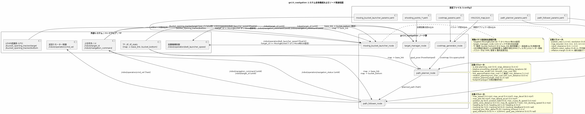
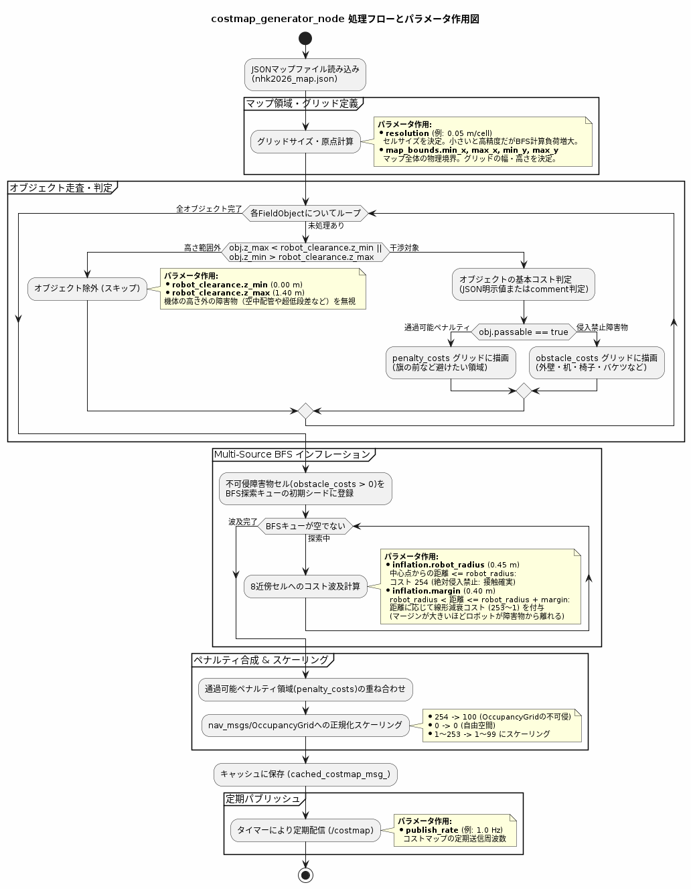
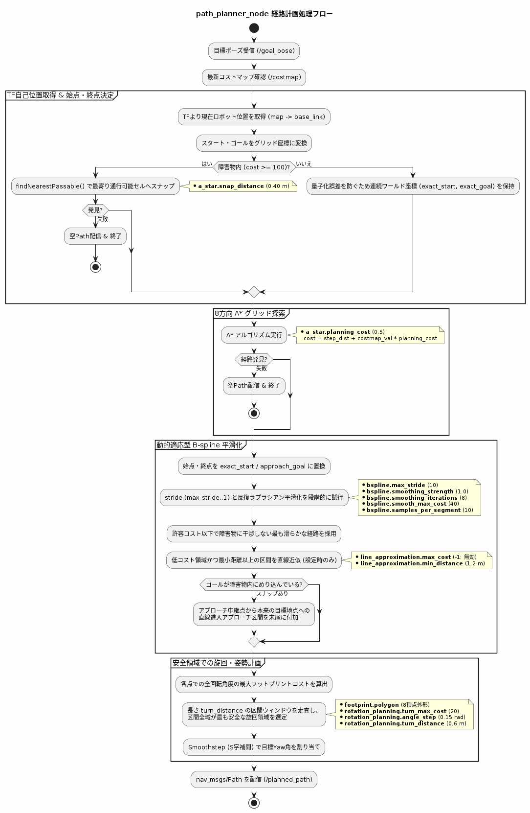
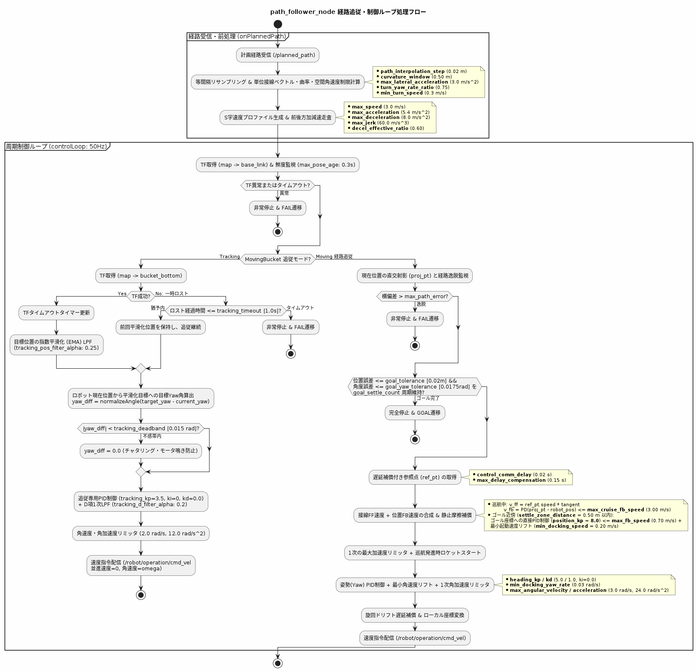
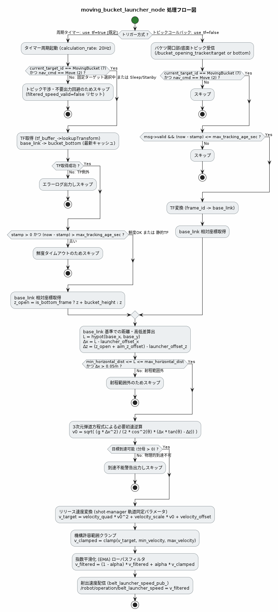

# gn10_navigation 処理フローおよびパラメータ詳細ガイド

本ドキュメントでは、NHKロボコン2026向け自動移動パッケージ `gn10_navigation` の各処理アルゴリズム、制御数式、およびパラメータの作用について詳細に解説します。
各処理フロー図は同ディレクトリ内の PlantUML (`.pu`) ファイルおよびレンダリングされた PNG 画像と対応しています。

---

## 1. 全体アーキテクチャ (`navigation_system_architecture.pu`)



```
[ 上位司令 / UI (udp_node) ]
       │ (/robot/target_id, /robot/navigation_command)
       ├─────────────────────────────────┬─────────────────────────────────┐
       ▼                                 ▼                                 ▼
[ target_manager_node ]           [ path_follower_node ]           [ moving_bucket_launcher_node ]
       │ (/goal_pose)                    ▲                                 ▲
       ▼                                 │ (/planned_path)                 │ (TF: base_link -> bucket_bottom)
[ path_planner_node ] ───────────────────┘                                 │
       ▲                                 │ (/cmd_vel)                      │ (/robot/operation/belt_launcher_speed)
       │ (/costmap)                      ▼                                 ▼
[ costmap_generator_node ]        [ 足回りモーター制御 ]              [ 投擲機構制御 ]
```

### ノードの責務とデータフロー
- **`target_manager_node`**: Target IDに応じた目標ポーズ（`/goal_pose`）を発行。固定ターゲット時は設定ファイルに定義された射出速度を発行し、移動バケツ追従（Target ID 7: `MovingBucket`）時は射出速度発行をスキップして `moving_bucket_launcher_node` に委ねます（排他制御）。
- **`costmap_generator_node`**: フィールド障害物定義（`nhk2026_map.json`）から Multi-Source BFS を用いてインフレーション付きコストマップ（`/costmap`）を定期配信します。
- **`path_planner_node`**: 8方向A*探索、始点終点の連続座標スナップ、動的適応型B-spline平滑化、および安全領域での旋回・姿勢計画により、量子化誤差や急激な加減速・干渉のない計画経路（`/planned_path`）を生成します。
- **`path_follower_node`**: 幾何学的制約と運動連鎖則を考慮した速度プロファイル計画、遅延補償付き接線フィードフォワード(FF)＋直交位置フィードバック(FB)統合制御、1次加速度リミッタ、およびゴール近傍の静止摩擦補償により、最高速度 3.0 m/s の高速追従と ±20mm / ±1.0 度の精密停止を実現します。また移動バケツ追従（Tracking）時はEMA平滑化と不感帯（デッドバンド）により滑らかな正対旋回を行います。
- **`moving_bucket_launcher_node`**: 移動バケツ追従（Target ID 7）かつ動作命令 `Move` の間、TF（既定: `bucket_bottom`）から得られる相対座標に基づき3次元弾道方程式をリアルタイム逆算し、指数平滑化（EMA）を経て `/robot/operation/belt_launcher_speed` へ動的配信します。

---

## 2. コストマップ生成 (`costmap_generator_flow.pu`)



### アルゴリズムの詳細
1. **JSONマップ読み込みと幾何干渉判定**:
   - `nhk2026_map.json` から直方体（BOX）や円柱（CYLINDER）の障害物・ペナルティ領域を読み込みます。
   - ロボットの鉛直通過クリアランス `robot_clearance.z_min` 〜 `z_max`（0.0m 〜 1.4m）と交差しない障害物（空中配管や超低段差など）は干渉対象外として除外します。
2. **Multi-Source BFS（多始点幅優先探索）によるインフレーション**:
   - 障害物の輪郭セル（`obstacle_costs > 0`）を初期キューに全登録し、8近傍グリッド探索により各セルから最寄り障害物までの最短ユークリッド距離 $d$ を計算します。
   - **不可侵領域 ($d \le \text{robot\_radius}$)**:
     機体幾何中心がこの距離内に入ると機体外形が障害物に確実に接触するため、コスト 254（OccupancyGrid: 100）を割り当てます。
   - **減衰マージン領域 ($\text{robot\_radius} < d \le \text{robot\_radius} + \text{margin}$)**:
     距離 $d$ に応じて線形に減衰するコスト（253 〜 1 / OccupancyGrid: 99 〜 1）を付与します。
     $$\text{cost} = \text{round}\left( 253 \times \left(1.0 - \frac{d - \text{robot\_radius}}{\text{margin}}\right) \right)$$
   - **自由空間 ($d > \text{robot\_radius} + \text{margin}$)**:
     障害物の影響を受けない安全空間としてコスト 0 を付与します。
3. **ペナルティ領域の重ね合わせと正規化**:
   - 通過可能だが走行を避けたい領域（旗の前など）を `penalty_costs` として重ね合わせ、最終的に `nav_msgs/msg/OccupancyGrid`（0〜100）へ変換して配信します。

### パラメータの作用 (`config/costmap_params.yaml`)
| パラメータ名 | 設定値 | 単位 | 作用とチューニング指針 |
|---|---|---|---|
| `publish_rate` | 1.0 | Hz | コストマップのパブリッシュ周波数。静的マップ運用の場合は 1.0 Hz で十分（CPU負荷抑制）。 |
| `resolution` | 0.05 | m/cell | 1セルのグリッド解像度（50mm）。小さくすると障害物境界が高精度になるがメモリと探索計算量が増大。 |
| `map_bounds.min_x / max_x` | -6.0 / 6.0 | m | マップ全体のX軸物理探索境界。 |
| `map_bounds.min_y / max_y` | -6.5 / 6.5 | m | マップ全体のY軸物理探索境界。 |
| `robot_clearance.z_min / z_max` | 0.0 / 1.4 | m | 障害物との干渉判定を行う高さ下限・上限。 |
| `inflation.robot_radius` | 0.45 | m | 機体中心点基準の不可侵半径。外接半径（約0.596m）未満に設定することで、壁際や教壇への近接アプローチを許容。 |
| `inflation.margin` | 0.40 | m | 回避コストを線形波及させるマージン幅。大きくすると安全マージンを多く取って障害物から離れ、小さくすると壁際ギリギリの狭路を通行可能になります。 |

---

## 3. 経路計画 (`path_planner_flow.pu`)



### アルゴリズムの詳細
1. **自己位置取得と安全スナップ**:
   - TF (`map -> base_link`) より現在位置を取得。
   - 始点またはゴールが障害物内（$\text{cost} \ge 100$）にある場合、BFS探索で `a_star.snap_distance`（0.4m）内の最寄り通行可能セルへ安全にスナップします。
   - ゴールが教壇への突き当て接触位置など障害物内部にある場合、通行可能セルを「安全アプローチ中継点」としてA*探索を行い、本来の目標地点への直線進入アプローチ区間を末尾に結合します。
   - 格子量子化による段差や誤差を防ぐため、始点・終点は元の正確な連続ワールド座標（`exact_start`, `exact_goal`）を保持します。
2. **8方向 A* 格子探索**:
   - 評価関数 $f(n) = g(n) + h(n)$
   - 移動コスト: $g(n) = g(\text{parent}) + \Delta s + \text{costmap\_val} \times \text{a\_star.planning\_cost}$
   - ヒューリスティック $h(n)$: ゴールまでのユークリッド距離。
3. **動的適応型 B-spline 平滑化 & 直線近似**:
   - A*の折れ線経路に対し、制御点間引きステップ幅 `stride` を `max_stride`（10）から 1 へ段階的に低減しながら、反復ラプラシアン平滑化（隣接点の中点ブレンドを `smoothing_iterations` 回反復）を適用します。
   - 経路上の全サンプルのセルコストが `smooth_max_cost`（40）以下となる最大の `stride` を自動採用します。広い空間では大きな `stride` で一気に滑らかな大半径円弧を描き、障害物の近傍では小さな `stride` で安全な迂回を維持します。
   - 直線近似（`line_approximation.max_cost`）: 低コスト領域かつ最小距離以上の区間を直線化（現在設定 `-1` で無効化中）。
4. **安全領域での旋回・姿勢計画 (planOrientations)**:
   - 機体の8頂点外形ポリゴン（`footprint.polygon`）を経路上の各点で 360 度（`angle_step` 0.15 rad 刻み）回転させた際の最大フットプリントコストを算出。
   - 長さ `turn_distance`（0.6m）の移動区間ウィンドウを走査し、区間全域で全方位のフットプリントコストが `turn_max_cost`（20）以下かつ最小となる「最も広い安全領域」を選定。
   - 3次S字関数 Smoothstep（$S(t) = 3t^2 - 2t^3$）を用いて、安全区間内で開始Yawから目標Yawへ滑らかに姿勢角を補間します。これにより壁際での機体カドの接触を完全に防止します。

### パラメータの作用 (`config/path_planner_params.yaml`)
| パラメータ名 | 設定値 | 単位 | 作用とチューニング指針 |
|---|---|---|---|
| `a_star.planning_cost` | 0.5 | - | コストマップ値に対する重み係数。大きくすると障害物のインフレーションマージンを避けて遠回りし、小さくすると幾何学的な最短経路を優先。 |
| `a_star.snap_distance` | 0.40 | m | 障害物内セルから通行可能セルを探す最大探索半径。 |
| `bspline.samples_per_segment` | 10 | 点 | B-spline 制御点間の補間サンプル密度。 |
| `bspline.smoothing_strength` | 1.0 | - | 1反復あたりの内部制御点を隣接点の中点へ寄せる割合（0.0〜1.0）。 |
| `bspline.smoothing_iterations` | 8 | 回 | 内部制御点の反復ラプラシアン平滑化回数。増やすほど階段状ノイズが除去され滑らかになります。 |
| `bspline.max_stride` | 10 | ステップ | 動的適応平滑化で試行する制御点間引き幅の最大値。広い直線空間で滑らかな軌道を生成。 |
| `bspline.smooth_max_cost` | 40 | コスト | 平滑化経路が通過を許容する最大セルコスト。この値を超えるショートカットは棄却され安全マージンが確保されます。 |
| `line_approximation.max_cost` | -1 | コスト | 直線近似を許容する最大コスト（`-1` は無効）。 |
| `line_approximation.min_distance` | 1.2 | m | 直線化を適用する最小セグメント長。 |
| `footprint.polygon` | 8頂点 | m | 機体の実外形ポリゴン（全長約0.985m、全幅約1.120m）。 |
| `rotation_planning.turn_max_cost` | 20 | コスト | 旋回区間全域で許容する最大フットプリントコスト。壁際や狭路での旋回を禁止し広い空間で旋回させます。 |
| `rotation_planning.angle_step` | 0.15 | rad | 旋回干渉判定の角度ステップ（約8.6度）。細かくすると判定精度向上、粗くすると計算時間短縮。 |
| `rotation_planning.turn_distance` | 0.60 | m | 旋回動作を完了させる移動区間長。 |

---

## 4. 経路追従 (`path_follower_flow.pu`)



### アルゴリズムの詳細
1. **経路受信・前処理 (`onPlannedPath`)**:
   - 計画経路を `path_interpolation_step`（0.02m）間隔でリサンプリングし、単位接線ベクトルおよび幾何曲率 $\kappa$ を計算。
   - **幾何横加速度制限**:
     遠心力 $a_{\text{lat}} = v^2 |\kappa| \le a_{\text{lat,max}}$ より、並進速度上限を算出：
     $$v \le \sqrt{\frac{a_{\text{lat,max}}}{\max(|\kappa|, \epsilon)}}$$
   - **旋回角速度要求制限**:
     運動連鎖則 $\omega = \frac{d\theta}{dt} = \frac{d\theta}{ds} \cdot \frac{ds}{dt} = \kappa_{\theta} \cdot v$ より、急旋回区間で並進が先行して旋回が追いつかなくなる現象を防止するため、フィードバック余裕 `turn_yaw_rate_ratio`（0.75）を残した速度上限を適用：
     $$v \le \max\left(\text{min\_turn\_speed}, \frac{\omega_{\text{max}} \cdot \text{turn\_yaw\_rate\_ratio}}{|d\theta/ds|}\right)$$
   - **ロケットスタート初速ランプ & S字プロファイル**:
     発進ダッシュを機敏にしデッドロックを防ぐため、初速ランプ $v = \sqrt{v_0^2 + 2 a_{\text{acc}} s}$ を適用。また最大躍度 `max_jerk`（60 m/s³）によるS字加減速プロファイルを重畳。
   - **加減速走査**:
     - 前方走査 (加速制限): $v_i \le \sqrt{v_{i-1}^2 + 2 a_{\text{acc}} \Delta s}$
     - 後方走査 (減速制限): $v_{i-1} \le \sqrt{v_i^2 + 2 (a_{\text{dec}} \cdot \text{decel\_effective\_ratio}) \Delta s}$ により、コーナー進入時やゴール停止に向けて手前から確実に減速。
2. **周期制御ループ (`controlLoop`: 50Hz)**:
   - **TF自己位置監視**: `map -> base_link` の遅延時間（`max_pose_age`: 0.3s）を監視し、異常時は即時非常停止（FAIL）。
   - **移動バケツ追従モード (Tracking)**:
     - TF (`map -> bucket_bottom`) を取得。一時欠損時は `tracking_timeout`（1.0s）まで角速度を減速させつつ待機。
     - 目標座標に指数平滑化（EMA）ローパスフィルタ（`tracking_pos_filter_alpha`: 0.25）を適用し、LiDAR計測ジッターを除去。
     - 目標Yaw角誤差に対し不感帯（`tracking_deadband`: 0.015 rad = 約0.86度）を適用し、目標正対時のモータ鳴き・車輪微振動を解消。
     - 追従専用PID制御（`tracking_kp`: 3.5, `tracking_kd`: 0.0）＋角速度・角加速度リミッタで旋回追従。
   - **経路追従モード (Moving)**:
     - 現在位置を経路へ直交射影し、横偏差が `max_path_error`（0.3m）を超過した場合は非常停止（FAIL）。
     - ゴール判定: ゴール近傍（`settle_zone_distance`: 0.5m以内）かつ位置誤差 $\le$ `goal_tolerance`（0.02m）、角度誤差 $\le$ `goal_yaw_tolerance`（0.0175 rad）を `goal_settle_count`（5周期連続）維持で Goal 確定。
     - **遅延補償参照点 (`ref_pt`) と直交射影点 (`proj_pt`)**:
       - 制御・通信遅延時間（$\text{total\_delay} = \text{pose\_age} + \text{control\_comm\_delay}$）先読みした接線速度 $\boldsymbol{v}_{\text{ff}} = v_{\text{ref}} \boldsymbol{t}$ を生成。
       - 直交射影点への横ズレ補正 $\boldsymbol{v}_{\text{fb}} = K_p \boldsymbol{e} + K_d \dot{\boldsymbol{e}}$（`max_cruise_fb_speed`: 3.0 m/s でクランプ）を合成。
       - ゴール近傍（`settle_zone_distance` 以内）では、ゴール座標への直接PID制御（`position_kp`: 8.0, `max_fb_speed`: 0.7 m/s）と最小起動速度リフト（`min_docking_speed`: 0.2 m/s）により静止摩擦を克服して収束。
     - **1次最大加速度リミッタ**: 1周期あたりの速度変化量を $a_{\text{limit}} \Delta t$ 以内に制限。
     - **姿勢PID制御**: 目標YawへのPID制御（`heading_kp`: 5.0, `heading_kd`: 1.0）＋1次角加速度リミッタ。

### パラメータの作用 (`config/path_follower_params.yaml`)
| パラメータ名 | 設定値 | 単位 | 作用とチューニング指針 |
|---|---|---|---|
| `control_rate` | 50.0 | Hz | 制御ループ周期（20ms周期）。 |
| `max_speed` | 3.0 | m/s | 機体の最高許容並進速度。直線巡航時の上限値。 |
| `max_acceleration` | 5.4 | m/s² | 最大並進加速度。発進・加速時の応答性を決定。 |
| `max_deceleration` | 8.0 | m/s² | 最大並進減速度。急停止および減速プロファイルの限界値。 |
| `max_jerk` | 60.0 | m/s³ | S字プロファイル生成時の最大躍度。小さいほど加減速が滑らかになり車輪スリップを防止。 |
| `max_lateral_acceleration` | 3.0 | m/s² | コーナー旋回時の最大許容遠心加速度。カーブ通過速度を自動制限。 |
| `curvature_window` | 0.50 | m | 曲率計算のサンプル窓幅。長くすると経路の局所ノイズに強くなり安定した速度制限が得られます。 |
| `decel_effective_ratio` | 0.60 | - | 後方減速走査の実効減速度比率。マージンを持たせて手前から確実に減速を完了させます。 |
| `position_kp` | 8.0 | - | 位置フィードバックPゲイン。横偏差の引き戻しおよびゴール直接PIDに作用。 |
| `position_ki / kd` | 0.0 / 0.0 | - | 位置I/Dゲイン。 |
| `max_cruise_fb_speed` | 3.00 | m/s | 巡航中の位置フィードバック速度上限。 |
| `max_fb_speed` | 0.70 | m/s | ゴール近傍（`settle_zone_distance` 以内）の位置FB速度上限。オーバーシュートを抑止。 |
| `min_docking_speed` | 0.20 | m/s | ゴール近傍で静止摩擦に負けて停止するのを防ぐ最小起動速度リフト。 |
| `settle_zone_distance` | 0.50 | m | ゴール直接PIDおよび精密停止モードへ切り替える残距離閾値。 |
| `heading_kp` | 5.0 | - | 姿勢 (Yaw) 制御のPゲイン。目標角度への追従応答性を決定。 |
| `heading_kd` | 1.0 | - | 姿勢 (Yaw) 制御のDゲイン。旋回のオーバーシュートを抑制。 |
| `heading_ki` | 0.0 | - | 姿勢 (Yaw) 制御のIゲイン。 |
| `heading_d_filter_alpha` | 0.60 | - | 姿勢D項の1次EMAローパスフィルタ係数。微分ノイズによるモータ鳴きを低減。 |
| `min_docking_yaw_rate` | 0.03 | rad/s | 目標角度付近での静止摩擦による微小残留偏差を解消する最小角速度リフト。 |
| `max_angular_velocity` | 3.0 | rad/s | 最大旋回角速度（約172 deg/s）。 |
| `max_angular_acceleration` | 24.0 | rad/s² | 最大旋回角加速度。旋回指令の急峻な変化を制限。 |
| `goal_tolerance` | 0.02 | m | ゴール到達位置許容誤差（±20mm）。 |
| `goal_yaw_tolerance` | 0.0175 | rad | ゴール到達姿勢許容誤差（±0.0175 rad = 約1.0度）。 |
| `goal_settle_count` | 5 | 周期 | 許容誤差内を維持し続けなければならない連続制御周期数（5周期 = 0.1秒）。 |
| `max_path_error` | 0.30 | m | 巡航中の最大許容経路横偏差。超過時は即座に非常停止（FAIL）。 |
| `max_pose_age` | 0.30 | s | 自己位置TF（`map -> base_link`）の許容最大遅延時間。超過時は安全停止。 |
| `control_comm_delay` | 0.02 | s | 制御・通信遅延時間。参照点先読み補償に使用。 |
| `tracking_kp` | 3.5 | - | 移動バケツ追従専用Yaw比例ゲイン。 |
| `tracking_kd` | 0.0 | - | 移動バケツ追従専用Yaw微分ゲイン。 |
| `tracking_deadband` | 0.015 | rad | 追従目標角度誤差の不感帯（約0.86度）。正対時の微小チャタリング・モータ鳴きを防止。 |
| `tracking_pos_filter_alpha` | 0.25 | - | map座標系での目標バケツ位置EMA平滑化係数。LiDAR重心計測ジッターを除去。 |
| `tracking_timeout` | 1.0 | s | バケツTF一時ロスト時の追従猶予時間。瞬断時の即時FAILを防止。 |

---

## 5. 移動バケツ追従射出速度計算 (`moving_bucket_launcher_flow.pu`)



相手ロボット上の可動バケツ（Target ID 7: `MovingBucket`）に対し、TF（既定: `bucket_bottom`）から `base_link` 基準で直動ベルトの射出速度をリアルタイムに逆算します。

### アルゴリズムの詳細
1. **排他配信制御**:
   - `target_id == MovingBucket (7)` かつ `navigation_command == Move (2)` の時のみ計算およびパブリッシュを実行。固定ターゲット時や `Sleep` / `Stanby` 時は配信を停止し、内部のEMAフィルタ状態をリセットして `target_manager_node` との競合を完全に回避します。
2. **位置取得方式（TF同期またはトピックコールバック）**:
   - `use_tf == true`（既定）: `calculation_rate`（20Hz）周期タイマーで `bucket_frame`（`bucket_bottom`）の `base_link` 相対座標を TF バッファから直接取得。
   - `is_bottom_frame == true` の場合は Z 座標に `bucket_height`（0.255m）を加算して上部開口部中心高さを自動算出：
     $$z_{\text{open}} = z_{\text{bottom}} + \text{bucket\_height}$$
3. **有効性・鮮度検証**:
   - 動的TF時は `(now - stamp) <= max_tracking_age_sec`（0.5s）を満たす場合のみ処理継続。
4. **3次元放物弾道方程式による初速逆算とリリース速度変換**:
   - `base_link` 原点からの水平距離 $L = \sqrt{x^2 + y^2}$ と有効リリース位置からの水平飛行距離 $\Delta x = L - x_0$、および目標高さ差 $\Delta z = (z_{\text{open}} + \text{aim\_z\_offset}) - z_0$ を算出。
   - 3次元放物弾道方程式より必要初速 $v_0$ を逆算：
     $$v_0 = \sqrt{\frac{g \Delta x^2}{2 \cos^2\theta (\Delta x \tan\theta - \Delta z)}}$$
     ここで $g = 9.80665\ \text{m/s}^2$、$\theta = \text{launch\_angle\_deg}$（48.09 deg）。
   - 実機射出ベルト速度変換多項式：
     $$v_{\text{belt}} = \text{velocity\_quad} \cdot v_0^2 + \text{velocity\_scale} \cdot v_0 + \text{velocity\_offset}$$
5. **クランプ & 指数平滑化 (EMA) & 配信**:
   - 機構許容範囲（`min_velocity` 2.50 〜 `max_velocity` 7.75 m/s）へクランプ。
   - 指数平滑化ローパスフィルタ（$\alpha = \text{speed\_filter\_alpha}$: 0.25）を適用：
     $$v_{\text{filtered}} = (1 - \alpha) v_{\text{prev}} + \alpha v_{\text{clamped}}$$
   - `/robot/operation/belt_launcher_speed` へ発行。

### パラメータの作用 (`config/moving_bucket_launcher_params.yaml`)
| パラメータ名 | 設定値 | 単位 | 作用とチューニング指針 |
|---|---|---|---|
| `base_frame` | `base_link` | - | 軌道計算を行う基準ロボット座標系。 |
| `bucket_frame` | `bucket_bottom` | - | TF追従対象のバケツ座標系フレーム。 |
| `use_tf` | `true` | - | TFキャッシュから周期タイマーで目標位置を取得するかどうか（`path_follower` と同一ソース）。 |
| `is_bottom_frame` | `true` | - | `bucket_frame` が底面か（`true` の場合 Z 座標に `bucket_height` を自動加算）。 |
| `calculation_rate` | 20.0 | Hz | TF基準の速度計算・配信タイマー周期。 |
| `speed_filter_alpha` | 0.25 | - | 射出目標速度の1次EMAローパスフィルタ係数。距離計測ノイズによる速度チャタリングを抑制。 |
| `bucket_height` | 0.255 | m | バケツ底面から上部開口部までの高さ。 |
| `aim_z_offset` | 0.000 | m | 上部開口部中心に対する狙い高さオフセット。 |
| `launcher_offset_x` | 0.179 | m | `base_link` 基準の有効リリース位置Xオフセット $x_0$。 |
| `launcher_offset_z` | 0.837 | m | `base_link` 基準の有効リリース位置Z高さ $z_0$。 |
| `launch_angle_deg` | 48.09 | deg | 有効リリース仰角 $\theta$。 |
| `velocity_quad` | 0.005 | - | 弾道初速 $v_0$ からベルトリリース速度への2次補正係数。 |
| `velocity_scale` | 1.000 | - | 弾道初速 $v_0$ からベルトリリース速度への1次スケーリング係数。 |
| `velocity_offset` | -1.5000 | m/s | ベルトリリース速度の定数オフセット。 |
| `min_velocity / max_velocity` | 2.50 / 7.75 | m/s | 射出ベルトの物理機構上下限リミット。 |
| `min_horizontal_dist / max_horizontal_dist` | 0.6 / 5.5 | m | 弾道計算を許容する有効水平距離範囲。 |
| `max_tracking_age_sec` | 0.5 | s | バケツTF観測値の許容最大遅延時間。 |

---

## 6. デバッグツール

速度指令値・ホイール順運動学速度・TF実効速度の比較および軌道追従の可視化には [tracking_debugger.md](tracking_debugger.md) を参照してください。

```bash
ros2 launch gn10_navigation tracking_debugger.launch.py
```
